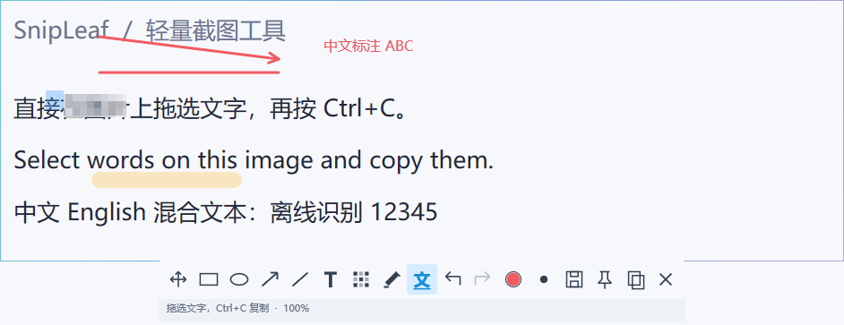

# 拾贴 SnipLeaf

轻量的 Windows 截图、标注、置顶贴图与离线 OCR 工具，支持可选的联网英译中。软件内名称为 **SnipLeaf**，最新安装版为 **0.1.15**。本次更新安装包和使用文档，公开应用源码仍为 **0.1.12**，采用 [MIT 许可证](LICENSE) 开源；版本对应关系见 [源码历史](docs/SOURCE_HISTORY.md)。

由于本人经常使用贴图功能辅助学习，同时希望贴图后可以复制文本便于操作。虽然市面上有众多工具，但其丰富的功能大多我没有使用需求，且它们体积较大，为此借助AI制作了一款轻量级截屏工具SnipLeaf，仅包含主要核心功能便于我日常使用。

**请使用管理员身份安装**

**F1 截图 → F3 贴到屏幕 → 在图片文字上拖选 → Ctrl+C 复制。**

*示例使用合成文字图片。*

## 功能

- **快捷截图**：框选屏幕区域，调整边界，拖动空白处移动选区；大选区的工具栏会保持在屏幕内，十字光标采用深色中心与白色描边。
- **八类标注**：箭头、直线、矩形、椭圆、文本、马赛克、直线记号笔和自由画笔，支持颜色、粗细、对象移动与调整，以及撤销／重做。
- **自由涂鸦**：按 **B** 使用自由画笔，笔迹跟随鼠标，支持圆点、闭合曲线和连续交叉绘制；按 V 选中后可移动、缩放、删除和撤销，随贴图保存与恢复。**P** 保持半透明直线记号笔。
- **文字标注**：透明输入框随内容伸缩，输入颜色与所选颜色一致，支持 **6–288 pt** 字号、拖动位置和双击修改。
- **置顶贴图**：将截图原位贴到桌面，保持原位置与尺寸；多张贴图独立移动、缩放和显隐，采用细渐变边框。同次运行中复制的截图，剪贴板未更换时再按 F3 也可恢复位置。
- **退出后恢复贴图**：自动保存未关闭的贴图，再启动时恢复图片、标注、位置、缩放、平移及隐藏状态；缓存使用当前 Windows 账户加密。主动关闭的贴图不再恢复，恢复后按 Tab 可继续编辑标注。
- **图片上直接选字**：截图和贴图都能拖选中文、英文，再复制文字；单击空白处取消选择。
- **离线增强 OCR**：内置 PP-OCRv6 Small 中英文模型，默认无需额外安装 .NET、Windows OCR 语言包或注册 MSIX 身份；支持逐字拖选、空格换行、大图分块和马赛克过滤，图片与识别正文不上传。可切换 Windows OCR 兼容引擎，默认模式执行失败时尝试回退。
- **直接覆盖升级**：运行 0.1.15 安装包即可更新到原目录，自动请求旧版保存贴图并退出，保留设置、翻译配置和贴图缓存。支持同版本重装，阻止降级；更新验证失败时尝试恢复旧版。
- **贴图标注锁定**：贴图默认锁定标注和文本框，仍可移动整张图片、缩放和 OCR 复制。按 **Tab** 显示工具栏后解锁编辑，隐藏工具栏时重新锁定。
- **联网英译中**：点击工具栏“译”，翻译所选文字或图片全文。英文原文和中文译文分别显示在上下两个文本框中，中文段落之间空一行，支持修正原文和整段复制。需要自行配置百度翻译账户。
- **原尺寸图片复制**：普通复制提供 PNG 和兼容位图格式；新增“复制 PNG 文件（原尺寸）”，便于通过文件方式分享。缩小贴图采用后台面积采样预览，右键可切换 100%／200% 阅读。

## 下载与安装

下载 [**SnipLeaf 0.1.15 x64 安装包**](https://github.com/Painter-Z/SnipLeaf/releases/download/v0.1.15/SnipLeaf-0.1.15-x64-Preview-Setup.exe)，或在 [0.1.15 Releases](https://github.com/Painter-Z/SnipLeaf/releases/tag/v0.1.15) 的 **Assets** 中选择 `SnipLeaf-0.1.15-x64-Preview-Setup.exe`。使用软件只需安装 EXE，无需下载源码或安装开发工具。安装包约 **29.67 MiB**，已包含中英文增强模型与所需运行时。

| 版本 | 说明 |
| --- | --- |
| [**0.1.15**](https://github.com/Painter-Z/SnipLeaf/releases/tag/v0.1.15) | 最新版：直接覆盖升级，保留配置和贴图；包含增强离线 OCR、自由画笔与新版工具栏 |

**现有安装包仍为试用签名。** 默认增强 OCR 不需要勾选安装向导中的证书信任选项；该项仅用于 Windows 兼容引擎。升级会沿用已有身份与证书所有权记录，不重复注册或下载语言。智能应用控制或企业策略仍可能阻止 EXE／DLL，管理员身份不保证绕过系统拦截。请先阅读 [安装说明](docs/INSTALLATION.md)。

1. 安装后从桌面或开始菜单启动 **SnipLeaf**，软件驻留在系统托盘。
2. 按 **F1** 拖动框选，完成标注后按 **F3** 贴到屏幕。
3. 等待文字识别，在图片文字上拖选，再按 **Ctrl+C**。
4. 保留贴图并从托盘退出，重启后会自动恢复。**Ctrl+W／Esc 最终关闭**表示不再保留；暂时收起请用 **Shift+F3**。

## 快捷键

以下为默认快捷键。截图、贴图快捷键可在托盘设置中调整；如与其他截图软件冲突，可改键或退出占用软件后重试。

| 快捷键／操作 | 功能 |
| --- | --- |
| **F1** | 截图 |
| **F3** | 截图时贴出当前选区；其他情况下贴出剪贴板图片 |
| **Shift+F3** | 隐藏／显示全部贴图 |
| **Tab** | 显示／隐藏当前贴图工具栏，同时解锁／锁定标注 |
| **O / V** | OCR 选字／选择和移动标注 |
| **A / L / R / E** | 箭头／直线／矩形／椭圆 |
| **T / M / P** | 文本／马赛克／直线记号笔 |
| **B** | 自由画笔，跟随鼠标涂鸦 |
| **Ctrl+C** | 有文字选区时复制文字，否则复制图片 |
| **Ctrl+Shift+C** | 强制复制图片 |
| **Ctrl+Shift+F** | 复制整张图片为原尺寸 PNG 文件 |
| **Ctrl+A** | 全选已识别文字；输入文本时全选输入内容 |
| **Ctrl+S** | 保存为 PNG |
| **Ctrl+Z / Ctrl+Y** | 撤销／重做；Ctrl+Shift+Z 也可重做 |
| **Delete（Del）/ Backspace** | 删除选中标注；文字输入时正常编辑字符 |
| **方向键 / Shift+方向键** | 将选中标注移动 1／10 个图片像素 |
| **鼠标滚轮 / Ctrl+0** | 缩放贴图／恢复 100% |
| **工具栏“译”／右键英译中** | 联网翻译所选文字或图片全文；翻译面板内 Ctrl+Enter 重译 |
| **Space+拖动** | 从文字或标注位置移动整张图片 |
| **Esc** | 取消当前输入、拖动或选择；没有这些状态时关闭当前截图／贴图 |
| **Ctrl+W** | 关闭当前截图／贴图 |

标注工具、删除、微调、撤销与重做在截图中，或贴图工具栏显示时生效。输入文本时，按键用于编辑文字；**Enter** 确认，**Shift+Enter** 换行。绘制直线／箭头／记号笔时按住 **Shift** 限制角度；绘制矩形／椭圆时按住 **Shift** 得到正方形／圆形。

## 系统要求与注意事项

- **Windows 11 x64** 已在本机验证；安装器最低要求为 Windows 10 2004，Windows 10 尚待独立实机验证。当前不提供 ARM64、32 位 Windows、macOS 或 Linux 版本。
- **增强 OCR 默认可直接使用**。模型随包提供，首次识别在后台加载，无需另行下载。设置中可切换 Windows OCR 兼容引擎，该路径才需要本地应用身份及系统 OCR 语言组件；下方“Windows 语言”仅作用于兼容引擎。密集文字和超长图片可能需要数秒至十余秒，期间仍可操作窗口。
- **0.1.15 支持覆盖升级**。直接运行新版安装包，自动请求旧版保存并退出，沿用原目录和一个卸载记录。文件被占用或权限不一致时，在替换前停止；更新验证失败时尝试恢复旧版，恢复受阻则保留备份并显示位置。**0.1.11 及更早版本退出前仍须手动保存图片**，升级无法找回旧版已丢弃的贴图。历史安装包原有的手动卸载要求保持不变。
- **贴图恢复使用本机加密缓存**。缓存位于 `%LOCALAPPDATA%\SnapLite\Pins`，包含原始底图与可编辑标注，不上传。更换 Windows 账户、重装系统或缓存损坏可能导致无法恢复；重要图片仍请保存 PNG。恢复时隐藏的贴图保持隐藏，断开的显示器上不可见的贴图会移回现有屏幕。详见 [贴图恢复说明](docs/PIN_SESSION.md)。
- **OCR 仍可能漏字或误识别**。密集文字、小字、模糊图需要核对，可右键选择“增强识别文字”重试。放大截图不能恢复原图没有的笔画；软件插入的文字和形状会按显示尺寸重绘。
- **联网翻译默认关闭**。在托盘“翻译设置…”中填写自己的百度通用文本翻译 APPID／密钥并启用。凭据由 Windows 加密保存，安装包不含共享密钥。主动翻译时仅将待译文字发送至百度，不上传图片；OCR 继续在本机运行。调用额度与费用以自己的百度账户为准，详见 [翻译说明](docs/TRANSLATION.md)。
- **向手机分享时可优先发送 PNG 文件**。右键“复制 PNG 文件（原尺寸）”或 Ctrl+Shift+F 后，在支持文件粘贴的应用中粘贴；如果微信仍按图片发送，可先保存 PNG，再选择文件附件发送。软件保留原尺寸，聊天应用的压缩和缩略图仍可能影响观感。
- **PNG 文件复制会保留本机分享缓存**。文件位于 `%LOCALAPPDATA%\SnapLite\Share`；每次成功复制新文件时，仅清理该目录下超过七天的自有分享 PNG，当前文件保留。普通图片复制不写入此目录。
- **保存 PNG 后，标注会合并为图片像素**。重新打开 PNG 时，原标注无法继续作为独立对象编辑。
- **当前为持续完善的试用版本**。0.1.15 最终签名程序通过 245 项功能与中英文 OCR；9 项实际安装器隔离升级检查、16 项部署和 31 项安装前提检查通过。0.1.14 同一模型的 9 张合成质量样本共 17,943 字符、81 个编辑错误，样本结果不代表所有截图准确率。干净 Windows 10／11、多屏混合缩放、HDR、不同安全策略及手机端传输效果仍需继续验证。

## 源码、文档与反馈

仓库 `main` 的应用代码仍为 **0.1.12**，本次只更新 **0.1.13–0.1.15 安装包和使用文档**。完整 0.1.12 源码可从 [source-v0.1.12](https://github.com/Painter-Z/SnipLeaf/tree/source-v0.1.12) 或 [0.1.12 发布页](https://github.com/Painter-Z/SnipLeaf/releases/tag/v0.1.12) 的 `SnipLeaf-0.1.12-source.zip` 下载。

`v0.1.13`–`v0.1.15` 标签固定本次安装包归档文档，GitHub 自动生成的 **Source code (zip / tar.gz) 仍含 0.1.12 应用代码，不能用于编译对应新版安装包**。最新安装包请下载各 Release 的 EXE。详见 [源码版本与历史](docs/SOURCE_HISTORY.md)。

旧版代码保存在 [source-v0.1.11](https://github.com/Painter-Z/SnipLeaf/tree/source-v0.1.11)、[v0.1.4](https://github.com/Painter-Z/SnipLeaf/tree/v0.1.4) 和 [source-v0.1.4](https://github.com/Painter-Z/SnipLeaf/tree/source-v0.1.4)。Git 提交与已有标签全部保留，可查看差异和下载旧版。

已发布的 `v0.1.5`–`v0.1.7` 和 `v0.1.11` 标签保留首次安装包归档时的状态，因此这些旧 Release 自动生成的 **Source code (zip / tar.gz)** 仍含 0.1.4 应用源码。0.1.0–0.1.3 没有可核实的对应应用源码快照，标签只保存发布文档。详见 [源码版本与历史](docs/SOURCE_HISTORY.md)。

- [快速入门](docs/QUICKSTART.md)
- [安装、更新与卸载](docs/INSTALLATION.md)
- [从源码构建](docs/BUILD.md)
- [源码版本与历史](docs/SOURCE_HISTORY.md)
- [常见问题](docs/FAQ.md)
- [联网翻译配置与使用](docs/TRANSLATION.md)
- [贴图自动保存与恢复](docs/PIN_SESSION.md)
- [版本记录](CHANGELOG.md)
- [资源与第三方说明](NOTICE.md)

欢迎通过 **Issues** 提交建议和问题。请附软件版本、Windows 版本、显示缩放比例及复现步骤；上传截图或日志前，请去除个人信息。欢迎提交改进代码，见 [参与开发](CONTRIBUTING.md)。
