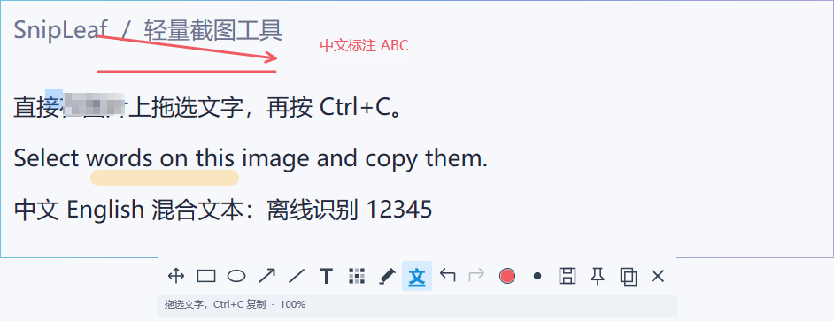

# 拾贴 SnipLeaf

轻量 Windows 截图、标注、置顶贴图与离线 OCR 工具。

**F1 截图 → F3 贴到屏幕 → 在图片文字上拖选 → Ctrl+C 复制。**

软件内名称为 **SnipLeaf**。本仓库提供安装包下载说明、使用文档和版本记录，源代码暂不公开。

*使用合成文字图片展示贴图和标注，未使用真实用户截图。*

## 下载

| 版本 | 用途 | 下载说明 |
| --- | --- | --- |
| **0.1.1 Preview** | 推荐试用，改善选字和文字输入操作 | [0.1.1 发布说明](docs/releases/v0.1.1.md) |
| 0.1.0 Preview | 历史版本，保留首版安装包 | [0.1.0 发布说明](docs/releases/v0.1.0.md) |

打开本仓库的 **Releases**，在对应版本的 **Assets** 中下载 `SnipLeaf-版本号-x64-Preview-Setup.exe`。每个安装包约 **2.3 MiB**，一个 EXE 即可安装；Windows OCR 语言组件的额外下载量不计入安装包体积。

**当前两个版本均为预览试用版。** 安装时需要明确同意信任专用测试证书，Windows 可能请求管理员确认；尚未采用公众信任的生产签名。详细步骤见 [安装说明](docs/INSTALLATION.md)。

## 可以做什么

- **快速截图**：F1 框选，调整边界，拖动空白处移动截图区域。
- **编辑标注**：矩形、椭圆、箭头、直线、文本、马赛克和直线记号笔；标注可再次选择、移动和调整，支持撤销与重做。
- **置顶贴图**：F3 将截图或剪贴板图片贴到屏幕上，多张贴图独立移动、缩放与显隐。
- **在原图选字**：截图和贴图都能拖选中文、英文，Ctrl+C 复制，无需切换到独立 OCR 结果窗口。
- **离线识别**：使用 Windows 系统 OCR，语言组件就绪后在本机处理截图和识别结果。
- **文字与显示**：6–288 pt 自定义字号、透明文字输入、矢量标注缩放、一像素渐变贴图边框。

## 三步上手

1. 安装后从开始菜单启动 SnipLeaf，软件驻留在系统托盘。0.1.x 的快捷方式可能仍显示“拾贴 SnipLeaf”。
2. 按 **F1** 拖动框选，完成标注后按 **F3** 贴到屏幕。
3. 等待后台识别，在图片文字上拖选，按 **Ctrl+C**。点击空白处取消选字；按住 **Space** 拖动，可从文字位置移动贴图。

贴图默认可以直接选字。按 **Tab** 展开标注工具栏；标注后按 **O** 回到选字模式。

## 常用快捷键

| 快捷键 | 操作 |
| --- | --- |
| F1 | 截图 |
| F3 | 贴出当前截图或剪贴板图片 |
| Shift+F3 | 隐藏／显示全部贴图 |
| O / V | 选字／选择标注 |
| Ctrl+C | 有文字选区时复制文字，否则复制图片 |
| Ctrl+Shift+C / Ctrl+S | 强制复制图片／保存 PNG |
| Ctrl+Z / Ctrl+Y | 撤销／重做 |
| Delete（Del）或 Backspace | 删除选中标注；输入文字时正常编辑字符 |
| 鼠标滚轮 / Ctrl+0 | 缩放贴图／恢复 100% |
| Esc | 取消当前编辑或选择，再次按下关闭贴图 |

完整操作见 [快速入门](docs/QUICKSTART.md)。

## 系统与安装要求

| 项目 | 当前情况 |
| --- | --- |
| Windows 11 x64 | 当前已在本机验证安装、截图、标注、贴图与中英文 OCR |
| Windows 10 | 安装器最低门槛为 2004；尚未完成独立实机验收 |
| ARM64、32 位 Windows、macOS、Linux | 当前不提供对应安装包 |
| OCR | 需要 Windows 中文／英文 OCR 可选组件；缺失时安装向导可请求 Windows 补齐，可能需要联网和重启 |
| 日常运行 | 普通用户权限，无需 VS Code、编译器、SDK 或 VC 运行库 |

更新 0.1.x 时，请先保存需要保留的贴图、退出程序并卸载旧版，再安装新版。卸载保留个人设置与 Windows OCR 语言组件。

## 当前验证范围

0.1.1 已在本机 Windows 11 x64 通过 **115 项功能检查**、中英文 OCR 样例和 **8 张合成 OCR 质量样本**。这些结果不代表已经覆盖所有电脑；干净机器、Windows 10、多屏混合 DPI、真实输入法候选窗口等场景仍需进一步验证。

密集文字、极小字和模糊图仍可能误识别。可在图片上右击选择“增强识别文字”重试，并核对重要文字。

## 使用文档与反馈

- [安装、更新与卸载](docs/INSTALLATION.md)
- [快速入门](docs/QUICKSTART.md)
- [常见问题](docs/FAQ.md)
- [版本记录](CHANGELOG.md)
- [使用与许可说明](NOTICE.md)

遇到问题可在本仓库 **Issues** 中提交版本、Windows 版本和复现步骤。附图或安装日志前，请先遮盖个人信息。

本项目尚未以开源许可证发布。GitHub 自动生成的 `Source code (zip/tar.gz)` 仅包含本仓库的文档和图片，**不是 SnipLeaf 应用源码或安装包**；使用软件请下载 Release 中的 EXE。
